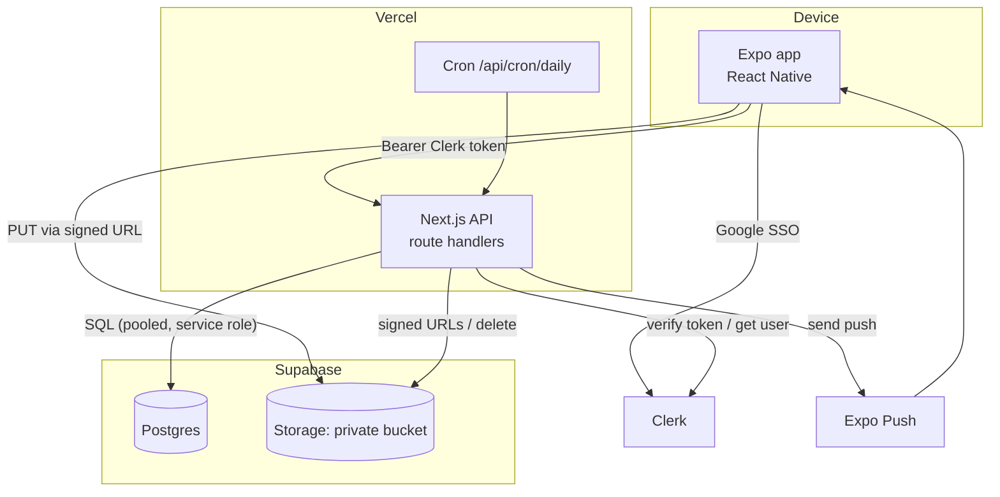
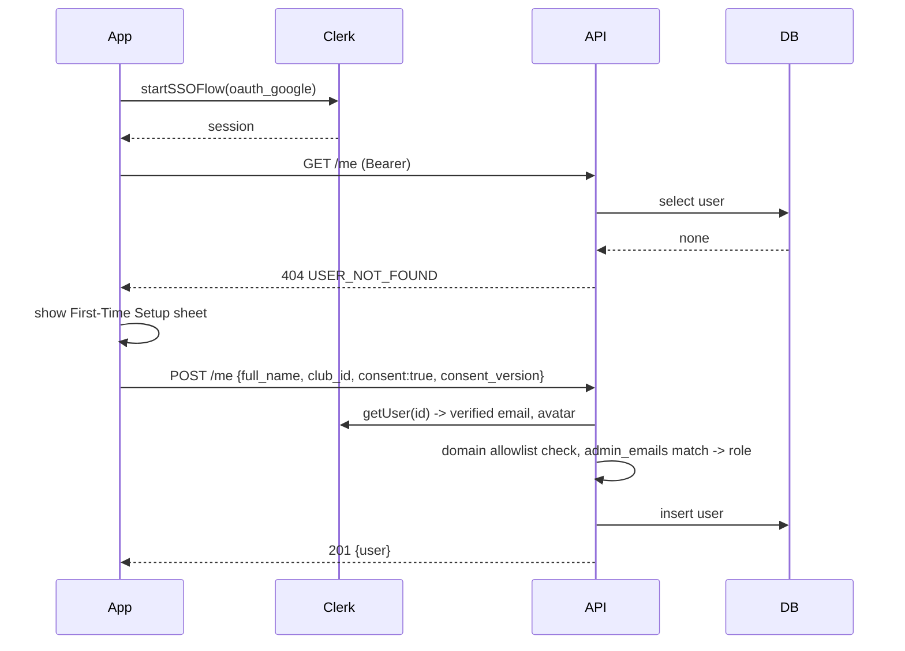
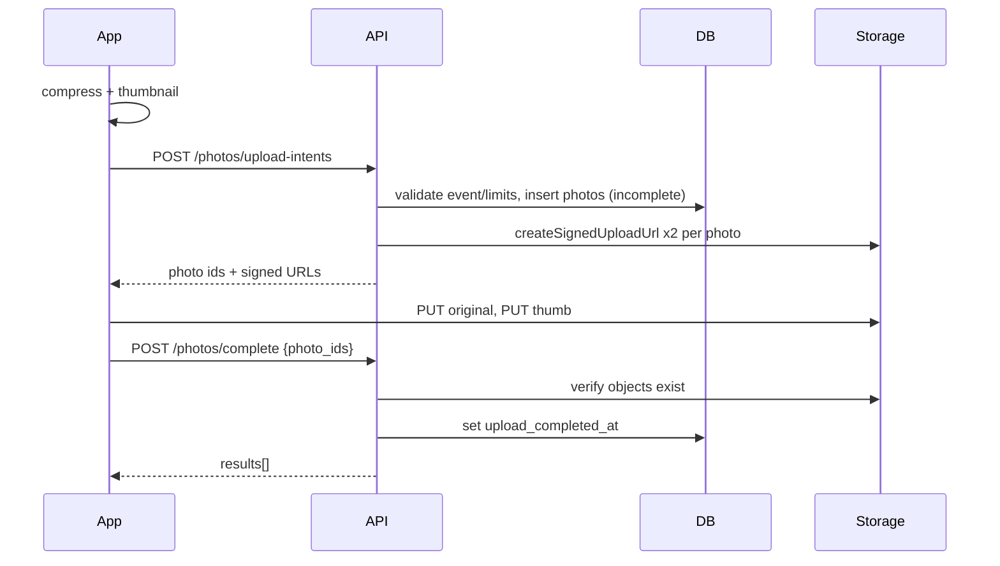

# Architecture

## 1. Overview

Three deployable parts plus managed services.



**Rules of the architecture**

- The mobile app **never talks to the database**. It talks to the API and, for file bytes only, to Storage using **signed upload URLs** minted by the API.
- The Supabase **anon key is never shipped**. The API uses a server-side connection (`DATABASE_URL`) and the service-role key (Storage only).
- RLS is **enabled with no policies** on every table (deny-all for PostgREST roles). Disable the Supabase Data API if possible.

## 2. Repository layout

```
apps/api/src/
  app/api/v1/**/route.ts       # thin handlers: parse, authenticate, call service, shape response
  app/api/cron/daily/route.ts
  server/
    lib/{env,auth,db,storage,errors,pagination,time,push,logger,withRoute}.ts
    services/{users,events,photos,review,reports,notifications,lookups}.ts
    sql/*.ts                   # SQL fragments/builders per aggregate (parameterized)
  middleware.ts                # clerkMiddleware()
apps/mobile/
  app/                         # expo-router routes (see ui-ux/pages-and-routes.md)
  src/
    api/{client,endpoints,errors}.ts
    features/{auth,home,events,upload,gallery,review,browse,reports,notifications,profile}/
    components/                # shared UI (see ui-ux/components.md)
    store/                     # zustand: uploadQueue, ui (theme, undo), session
    theme/{tokens,useTheme}.ts
    lib/{image,time,netinfo,push,format,haptics}.ts
packages/shared/src/{constants,schemas,types}.ts
supabase/{migrations/*.sql, seed.sql, config.toml}
```

## 3. Backend layering

`route.ts` → `withRoute({auth, role})` wrapper (auth, error mapping, logging) → **service** (business rules, transactions) → **sql** (postgres.js tagged templates).

- Services are framework-free and unit-testable with a DB.
- Every service function receives `ctx: { userId, role }`.
- Transactions use `sql.begin(...)` for multi-statement rules (replace flow, delete flows, review actions with notifications).
- Side effects after commit (push, notification rows) run via Next `after()` so they do not delay the response.

## 4. Mobile layering

- **Routes** compose screens; **feature hooks** wrap TanStack Query (`useEventsQuery`, `useMyPhotosInfinite`, `useApproveMutation`…).
- **API client** (`src/api/client.ts`): attaches `Authorization: Bearer <Clerk session token>` (fresh via `getToken()` each call), parses the error envelope, retries idempotent GETs with backoff, maps 401 to the session-expired state.
- **State**: server state in TanStack Query; local UI state in React state; cross-screen client state in Zustand (upload queue, pending undo, theme).
- **Sheets**: a single `SheetHost` (gorhom bottom sheet) controlled by a typed `openSheet(name, props)` store. Photo Viewer is a route (deep-linkable from notifications).

## 5. Key flows

### 5.1 First sign-in



### 5.2 Upload



### 5.3 Review with undo

Client holds decision 5 s → `POST /admin/photos/:id/approve|reject` → service updates status, sets reviewer fields; on reject inserts notification + push (`after()`).

### 5.4 Deadline reminders / cleanup

Vercel Cron `GET /api/cron/daily` at 01:00 UTC (09:00 Manila) with `Authorization: Bearer $CRON_SECRET`: (1) events with `deadline` in (now, now+48h] and `reminder_sent_at is null` → notifications + push, set `reminder_sent_at`; (2) delete incomplete uploads older than 24 h (rows + any storage objects).

## 6. Data access and files

- Bucket `yearbook-photos` (private, JPEG only, 5 MB limit). Paths: `originals/{event_id}/{uploader_id}/{photo_id}.jpg`, `thumbs/{event_id}/{uploader_id}/{photo_id}.jpg`.
- Reads: API returns `thumb_url` and `original_url` (signed, TTL 3600 s) inside DTOs. Mobile caches images with a stable `cacheKey` = `{photo_id}:{thumb|original}` so URL rotation does not defeat the cache.
- Writes: signed upload URLs (single object path, one-time token).
- Deletes: always storage first, DB second (BR-08).

## 7. Caching & freshness (mobile)

| Data                        | Stale time | Invalidation                                 |
| --------------------------- | ---------- | -------------------------------------------- |
| events                      | 30 s       | after admin event mutations; pull to refresh |
| my photos                   | 30 s       | after upload complete, edit, delete, replace |
| review queue / admin photos | 0–10 s     | after review actions, filters change         |
| notifications               | 30 s       | on push received, on sheet open              |
| lookups (categories, clubs) | 1 h        | none                                         |
| me                          | 5 min      | after profile edit                           |

## 8. Offline behavior

Read screens show cached data with an offline banner. Mutations require a connection (error toast). Uploads auto-retry on reconnect while the app is running (no persistence across restarts).

## 9. Observability

- API: structured JSON logs (request id, user id hash, route, status, duration). No PII. Vercel logs.
- Mobile: error boundary + optional Sentry (P2, see `roadmap.md`).
- Health: `GET /api/v1/health` (checks DB with `select 1`).

## 10. Scaling notes

Expected load is tiny (≤ 2,000 users). Bottlenecks to watch: Supabase free-tier storage (1 GB) and DB connections (use the pooler, `prepare: false`). See `technical/performance.md`.
