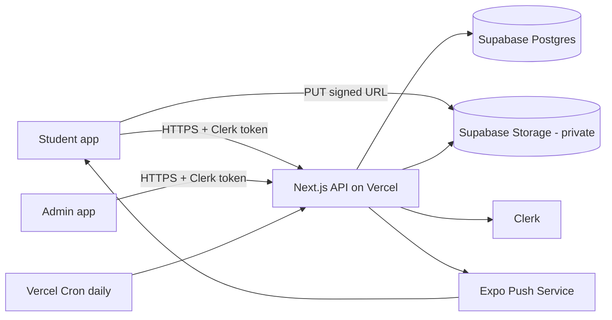

# YearbookHub — Overview

- **Status:** Approved for implementation
- **Last updated:** 2026-10-11
- **Platform:** Mobile app (Android APK first; iOS optional), React Native (Expo)
- **Start here**, then read `specification.md` (primary source of truth)

## 1. Problem

Yearbook committees collect hundreds of photos through scattered channels (email, USB drives, social DMs). They cannot easily organize by event, verify who submitted what, enforce deadlines, or reject poor photos with feedback. Generic file-sharing tools have no event tagging, deadlines, or review workflow.

## 2. Solution

A mobile app with two roles:

- **Students** sign in with Google, upload photos (camera or gallery, multi-select), tag them by event / category / optional club, and keep a private Instagram-style gallery of their own uploads.
- **Admins** (yearbook committee) review each photo (approve/reject with a reason), browse and filter all photos, manage events and deadlines, and handle removal requests.

## 3. Goals

1. Centralize photo collection in one place.
2. Reduce committee workload with a fast one-photo-at-a-time review flow.
3. Enforce per-event deadlines and per-student photo limits automatically.
4. Protect student privacy (private photos, consent, removal requests).
5. Be buildable by a small student team in 8 weeks.

## 4. Non-goals (v1)

Automated yearbook layout, in-app photo editing, public gallery, shared gallery between students, Club Officer role, email/password login, ZIP export, persistent offline queue, in-app user/role management. See `roadmap.md`.

## 5. Users

| Role    | Description                                  | Core needs                                                           |
| ------- | -------------------------------------------- | -------------------------------------------------------------------- |
| Student | Any enrolled student (club members included) | Upload, tag, see own photos, request removal, get rejection feedback |
| Admin   | Yearbook committee member (1–5 people)       | Review, browse/filter, manage events, handle reports                 |

## 6. Core capabilities

Google sign-in with required consent · multi-photo upload with auto-compression, progress, retry · event/category/club tagging · private "My Photos" gallery · admin review queue with undo · admin browse/filter/search · event + deadline management · removal requests · push notifications (deadline reminders, rejection feedback, report outcome).

## 7. App surface (fixed)

**6 full screens:** Sign In · Home (student) · Upload (student) · My Photos (student) · Admin Review (toggle: Review | All photos) · Admin Events.
**Tabs:** Student = Home · Upload · My Photos. Admin = Review · Events. Profile opens as a sheet from the avatar.
Everything else (sheets, overlays, dialogs, toasts, states) is listed in `specification.md`.

## 8. System context



## 9. Tech stack

| Layer                | Choice                                                                           |
| -------------------- | -------------------------------------------------------------------------------- |
| Mobile               | React Native + Expo (development build), expo-router, TypeScript, TanStack Query |
| Backend              | Next.js App Router route handlers (TypeScript), zod, postgres.js                 |
| Auth                 | Clerk (Expo SDK), Google SSO only                                                |
| Database             | Supabase Postgres (accessed only by the API)                                     |
| Files                | Supabase Storage, private bucket, signed URLs                                    |
| Push                 | Expo Push Notifications (FCM for Android)                                        |
| Build / Distribution | EAS Build (APK), Vercel (API), GitHub Actions (CI)                               |
| Design / tools       | Figma or design-tool output, Postman                                             |

## 10. Document map

| File / folder                            | Purpose                                                                                                |
| ---------------------------------------- | ------------------------------------------------------------------------------------------------------ |
| `requirements.md`                        | What must exist (IDs, priorities)                                                                      |
| `specification.md`                       | Exact behavior, copy, limits (**source of truth**)                                                     |
| `architecture.md`, `design-decisions.md` | Structure and rationale                                                                                |
| `plan.md`, `tasks.md`, `roadmap.md`      | Schedule, backlog, future                                                                              |
| `glossary.md`                            | Terms                                                                                                  |
| `technical/`                             | DB, data model, API, auth, authorization, integrations, environment, dependencies, errors, performance |
| `features/`                              | One file per feature area                                                                              |
| `ui-ux/`                                 | Design system, components, pages and routes, user flows                                                |
| `testing/`                               | Strategy, plan, cases, QA checklist, bug tracking                                                      |
| `deployment/`                            | Deployment, CI/CD, backup/recovery, troubleshooting                                                    |
| `security/`                              | Security, threat model, privacy, permissions matrix                                                    |
| `.github/workflows/`                     | Reference CI/CD workflow files (copy to the repo root `.github/`)                                      |

---

# 11. Instructions for coding agents (READ CAREFULLY)

You are building YearbookHub from these docs. **Do not guess. Look it up.**

## 11.1 Reading order (before writing any code)

1. `overview.md` (this file) → 2. `specification.md` → 3. `architecture.md` + `design-decisions.md` → 4. `technical/database.md`, `data-model.md`, `api.md` → 5. `security/permissions-matrix.md` → 6. `tasks.md` (pick the first unchecked task whose dependencies are done) → 7. the matching file in `features/` and `ui-ux/` before building each feature.

## 11.2 Non-negotiable rules

1. **Only two roles: `student` and `admin`.** No Club Officer. Club is just an optional tag.
2. **Students never see other students' photos.** The API only returns a student's own photos.
3. **Students never see status labels, tabs, counts, or badges** (Pending/Approved/Rejected). The student photo DTO has no `status` field. A student learns of a rejection only through a push notification and the "Needs a new photo" card in the viewer.
4. **Sign-in is Google only** (Clerk). No email/password, forgot-password, or OTP screens.
5. **All authorization is enforced on the server.** Never trust the client for role, ownership, deadline, or limits.
6. **The deadline is enforced on the server:** effective open = `is_open AND now() < deadline`.
7. **Only 6 full screens.** Everything else is a sheet, overlay, dialog, or state.
8. **Photos are private.** Private bucket; images served only via short-lived signed URLs from the API.
9. **Never log** emails, captions, tokens, signed URLs, or image data.
10. **Never commit secrets.** Use env vars (`technical/environment.md`).
11. Status is never shown by color alone: icon + label.
12. Primary buttons always use white text on the primary color.

## 11.3 Conflict precedence

`security/*` > `specification.md` > `requirements.md` > `technical/*` > `features/*` > `ui-ux/*` > others. Visual styling follows the design files (`ui-ux/design-system.md`); behavior follows these docs.

## 11.4 When the docs are silent or conflict

- Choose the simplest option that satisfies the non-negotiable rules.
- Record it in `design-decisions.md` → "Agent Decisions Log" (date, question, choice, reason).
- If it touches security, privacy, or data deletion: stop and ask the human.
- Never silently deviate. If a doc is wrong, fix the doc in the same PR.

## 11.5 Target repository layout

```
yearbookhub/
  docs/                      # this documentation
  apps/mobile/               # Expo (React Native, expo-router, TypeScript)
  apps/api/                  # Next.js App Router route handlers (backend)
  packages/shared/           # zod schemas, types, constants (mobile + api)
  supabase/migrations/       # SQL migrations (schema source of truth)
  supabase/seed.sql
  .github/workflows/
```

## 11.6 Conventions

- TypeScript `strict: true`; no `any` (use `unknown` + zod parse).
- Validate every API input/output with zod schemas from `packages/shared`.
- API layering: route handler (parse + auth) → service (business rules) → SQL (postgres.js, parameterized). No SQL in route files.
- Mobile layering: screen → feature hook (TanStack Query) → `src/api` client. No `fetch` in components.
- All limits, enums, labels, and copy live in `packages/shared/src/constants.ts` (see `specification.md` §2). Never hard-code a limit twice.
- Conventional Commits; one task ID per PR (e.g. `feat(upload): T-041 upload intents endpoint`).

## 11.7 Commands (after scaffolding; see `technical/environment.md`)

```
npm ci                               # npm workspaces, Node 22 LTS
npm run lint && npm run typecheck
npm run test
npm run dev --workspace apps/api     # http://localhost:3000
npx expo start --dev-client          # use a development build, not Expo Go
supabase start && supabase db reset  # local DB + migrations + seed
```

## 11.8 Definition of done (per task)

Meets the acceptance text in `tasks.md` and the matching spec section · lint/typecheck/tests pass · server-side authz + validation on every new endpoint · empty/loading/error/offline states handled as listed · docs updated if behavior changed · task checkbox ticked.
