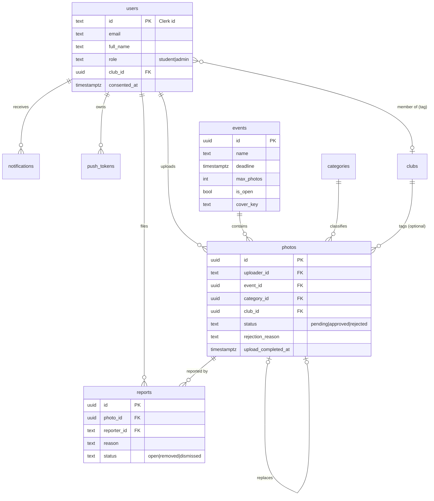

# Data Model

## 1. ERD



## 2. Entities

| Entity            | Purpose                                     | Owner of rows            |
| ----------------- | ------------------------------------------- | ------------------------ |
| users             | Profile, role, consent, notification prefs  | self (admin read-all)    |
| clubs, categories | Seeded tags                                 | system                   |
| admin_emails      | Allowlist for admin role on first sign-in   | DBA / manual             |
| events            | Collection periods with deadline and limits | admins                   |
| photos            | Uploaded images + review state              | uploader (admin review)  |
| reports           | Removal requests                            | reporter (admin resolve) |
| notifications     | In-app list + push payload record           | recipient                |
| push_tokens       | Expo push tokens per device                 | user                     |

## 3. Enums

| Name                   | Values                                                                                       |
| ---------------------- | -------------------------------------------------------------------------------------------- |
| role                   | `student`, `admin`                                                                           |
| photo status           | `pending`, `approved`, `rejected`                                                            |
| rejection reason       | `blurry`, `too_dark`, `inappropriate`, `duplicate`, `wrong_event`, `low_resolution`, `other` |
| report reason          | `remove_me`, `inappropriate`, `wrong_tag`, `copyright`, `other`                              |
| report status          | `open`, `removed`, `dismissed`                                                               |
| notification type      | `photo_needs_replacement`, `deadline_reminder`, `report_resolved`                            |
| event cover            | `sports`, `festival`, `graduation`, `science`                                                |
| event effective status | `open`, `closed` (derived)                                                                   |

## 4. Validation limits

| Field             | Rule                                                               |
| ----------------- | ------------------------------------------------------------------ |
| full_name         | 1–80 chars, trimmed                                                |
| event.name        | 2–80                                                               |
| event.description | 1–600                                                              |
| event.max_photos  | integer 1–50                                                       |
| event.deadline    | ISO 8601 with offset; on create must be in the future              |
| photo.caption     | ≤ 200 (empty allowed)                                              |
| rejection_note    | ≤ 300; required when reason = `other`                              |
| report.notes      | ≤ 300                                                              |
| upload file       | `image/jpeg`; original ≤ 5 MB; thumb ≤ 300 KB; width/height 1–6000 |
| batch             | 1–20 files                                                         |

## 5. DTOs (zod schemas live in `packages/shared/src/schemas.ts`; types shown as TypeScript)

```ts
type Id = string;
type ISO = string;
type Ref = { id: Id; name: string };

type UserDTO = {
  id: string;
  email: string;
  full_name: string;
  avatar_url: string | null;
  role: "student" | "admin";
  club: Ref | null;
  notify_deadlines: boolean;
  notify_reviews: boolean;
  consented_at: ISO;
};

type EventDTO = {
  id: Id;
  name: string;
  description: string;
  cover_key: "sports" | "festival" | "graduation" | "science";
  deadline: ISO;
  max_photos: number;
  is_open: boolean;
  status: "open" | "closed"; // effective
  my_photo_count?: number; // student responses
  photo_count?: number; // admin responses (completed photos)
  created_at: ISO;
};

// STUDENT view: no status field, ever.
type StudentPhotoDTO = {
  id: Id;
  event: Ref;
  category: Ref;
  club: Ref | null;
  caption: string;
  created_at: ISO;
  width: number;
  height: number;
  batch_size: number;
  thumb_url: string;
  original_url: string;
  needs_replacement: boolean;
  rejection: {
    reason: RejectionReason;
    label: string;
    note: string | null;
  } | null; // only when rejected
};

type TileDTO = {
  // grids
  id: Id;
  thumb_url: string;
  width: number;
  height: number;
  batch_size: number;
};
type AdminTileDTO = TileDTO & { status: PhotoStatus; reported: boolean };

type AdminPhotoDTO = {
  id: Id;
  status: PhotoStatus;
  uploader: {
    id: string;
    full_name: string;
    email: string;
    avatar_url: string | null;
    club: Ref | null;
  };
  event: Ref;
  category: Ref;
  club: Ref | null;
  caption: string;
  created_at: ISO;
  reviewed_at: ISO | null;
  reviewed_by: { id: string; full_name: string } | null;
  rejection: {
    reason: RejectionReason;
    label: string;
    note: string | null;
  } | null;
  consent_confirmed_at: ISO;
  width: number;
  height: number;
  batch_size: number;
  thumb_url: string;
  original_url: string;
  open_report: ReportDTO | null;
};

type ReportDTO = {
  id: Id;
  photo_id: Id | null;
  reporter: { id: string; full_name: string };
  reason: ReportReason;
  reason_label: string;
  notes: string | null;
  status: "open" | "removed" | "dismissed";
  created_at: ISO;
  resolved_at: ISO | null;
};

type NotificationDTO = {
  id: Id;
  type: NotificationType;
  title: string;
  body: string;
  data: { photo_id?: Id; event_id?: Id; report_id?: Id };
  read: boolean;
  created_at: ISO;
};

type Page<T> = { data: T[]; next_cursor: string | null };
```

## 6. Derived values

- `status` (event) = `is_open && now < deadline ? 'open' : 'closed'`.
- `batch_size` = count of completed photos with the same `batch_id`.
- Student stats: `photos` = completed own photos; `events` = distinct `event_id` among them.
- `needs_replacement` = `status = 'rejected'`.

## 7. Storage objects

`yearbook-photos/originals/{event_id}/{uploader_id}/{photo_id}.jpg` and `.../thumbs/...jpg`. One original + one thumb per photo; both required for `complete`.
