# Implementation Phases (Build Guide) — UI first

Order: **Installation → Frontend mockup (mock data) → Backend → Integration → Push → Polish → Test → Deploy → Defense.**
Complements `plan.md` (calendar), `tasks.md` (backlog IDs), `specification.md` (behavior).

**Why UI first:** the whole app is visible and demo-able early; the adviser can approve the look and flows before backend work; the frontend is built against a **mock API** that has the same contract as the real one (`technical/api.md`), so swapping to the real backend later is small.

**How to use:** finish a phase only when its **Gate** passes. Each phase ends with an **Agent prompt** you can paste to a coding agent.

## 0. Phase map

```mermaid
flowchart LR
  P0[P0 Tools] --> P1[P1 Install and scaffold]
  P1 --> P2[P2 Frontend mockup]
  P2 --> P3[P3 Backend accounts and database]
  P3 --> P4[P4 Backend foundation]
  P4 --> P5[P5 Backend features]
  P5 --> P6[P6 Integration mock to real]
  P6 --> P7[P7 Push notifications]
  P7 --> P8[P8 Polish]
  P8 --> P9[P9 Testing and QA]
  P9 --> P10[P10 Deployment]
  P10 --> P11[P11 Delivery and defense]
```



With two developers, **P3–P5 (backend) can start while P2 (UI mockup) is finishing**, because the contract is already fixed in `technical/api.md`.

| Phase | Name                            | Week (plan.md) | Task IDs                                                                                                                                                            | Est.   |
| ----- | ------------------------------- | -------------- | ------------------------------------------------------------------------------------------------------------------------------------------------------------------- | ------ |
| P0    | Tools & prerequisites           | 1–2            | T-001, T-002                                                                                                                                                        | 1 d    |
| P1    | Installation & scaffolding      | 2              | T-003, T-010, T-011                                                                                                                                                 | 1 d    |
| P2    | **Frontend mockup (mock data)** | 3–4            | T-020, T-200–T-204, T-025, T-027, T-033, T-042–T-045, T-051–T-053*, T-055, T-056, T-081, T-032, T-062, T-063, T-071–T-074*, T-082, T-093*, T-100, T-101 (*UI parts) | 8–10 d |
| P3    | Backend accounts & database     | 5              | T-004, T-005, T-006, T-012, T-016                                                                                                                                   | 1–2 d  |
| P4    | Backend foundation              | 5              | T-013, T-014, T-015, T-022, T-030                                                                                                                                   | 2 d    |
| P5    | Backend features                | 5–6            | T-031, T-040, T-041, T-050, T-053*, T-054, T-060, T-061, T-070, T-073*, T-074*, T-080, T-090, T-091, T-094, T-026* (*API parts)                                     | 6–8 d  |
| P6    | Integration (mock → real)       | 6–7            | T-210–T-214, T-021, T-023, T-024                                                                                                                                    | 3 d    |
| P7    | Push notifications              | 7              | T-092, T-093, T-095                                                                                                                                                 | 2 d    |
| P8    | Polish & states                 | 7              | T-102, T-103, T-104, T-026 (UI)                                                                                                                                     | 2 d    |
| P9    | Testing & QA                    | 7–8            | T-130–T-135                                                                                                                                                         | 4 d    |
| P10   | Deployment                      | 8              | T-150, T-151                                                                                                                                                        | 2 d    |
| P11   | Delivery & defense              | 8              | T-152–T-154                                                                                                                                                         | 2 d    |

---

## P0 — Tools & prerequisites (no backend accounts yet)

**Goal:** ready to code the UI.
**Do:**

1. Answer the open questions that affect the UI (`design-decisions.md` OQ-6: design files). Others can wait until P3.
2. Install: Node.js 22 LTS, Git, VS Code, Android Studio (emulator) **or** an Android phone with USB debugging, Expo account (expo.dev), EAS CLI (`npm i -g eas-cli`).
3. Create the GitHub repo `yearbookhub`; protect `main` (PR + CI).
4. Collect the design files/screenshots (admin screens exist; student screens pending). Export sample photos for mock data (see P2A).
   **Gate:** `node -v` ≥ 22; `git --version`; an Android device/emulator ready; repo exists.
   **Agent prompt:** _"Read overview.md §11 and design-decisions.md. List which open questions block the UI work and propose defaults. Do not write code."_

---

## P1 — Installation & scaffolding

**Goal:** a monorepo that installs, lints, and type-checks with empty apps.
**Do:**

```bash
git clone <repo> yearbookhub && cd yearbookhub
mkdir -p apps packages docs supabase
# copy this docs folder into ./docs and .github/workflows into ./.github/workflows

cat > package.json <<'JSON'
{ "name": "yearbookhub", "private": true,
  "workspaces": ["apps/*", "packages/*"],
  "scripts": {
    "lint": "npm run lint --workspaces --if-present",
    "typecheck": "npm run typecheck --workspaces --if-present",
    "test": "npm run test --workspaces --if-present",
    "format": "prettier --write ." } }
JSON

npx create-expo-app@latest apps/mobile                       # Expo + expo-router + TypeScript
npx create-next-app@latest apps/api --ts --app --src-dir --eslint --no-tailwind --import-alias "@/*" --use-npm   # backend shell (empty until P4)
mkdir -p packages/shared/src && cd packages/shared && npm init -y && cd ../..
# packages/shared: name "@yearbookhub/shared", main/types "src/index.ts", scripts typecheck/test
```

Then:

1. `"typecheck": "tsc --noEmit"` in each workspace; `"strict": true` in all tsconfigs.
2. Add `@yearbookhub/shared` to both apps (`npm i @yearbookhub/shared -w apps/api -w apps/mobile`); Next: `transpilePackages: ['@yearbookhub/shared']`.
3. **Fill `packages/shared` now:** `constants.ts` (spec §2), `types.ts` (DTOs from `technical/data-model.md` §5), zod schemas for DTOs. The mock API and the future backend both use these.
4. Install mobile dependencies from `technical/dependencies.md` with `npx expo install` (skip Clerk/notifications wiring for now; installing is fine). **Pin exact versions** afterward.
5. ESLint + Prettier, `.gitignore` (`.env*`, `.expo`, `.next`), `.env.example` files, `app.json` fields (`scheme`, `android.package`, plugins), `eas.json`; run `eas init` in `apps/mobile` when ready for builds.
6. Copy `.github/workflows/*.yml` to the repo root (the integration job can stay disabled until P3).
   **Deliverables:** monorepo, shared types/constants/schemas, CI running lint + typecheck.
   **Gate:** `npm ci && npm run lint && npm run typecheck` pass locally and in CI; `npx expo start` opens a blank app on a device.
   **Pitfalls:** Metro monorepo resolution (single React/RN version, workspace install); Expo Go is fine for P2 (see DD-017 amendment).
   **Agent prompt:** _"Do P1 from phases.md: scaffold the monorepo, pin versions, fill packages/shared with constants, DTO types and zod schemas from specification.md §2 and technical/data-model.md §5. Tasks T-003, T-010, T-011. Stop at the gate."_

---

## P2 — Frontend mockup (mock data, no backend)

**Goal:** the **complete app UI** — all 6 screens, sheets, dialogs, and states — running on a phone against an in-memory mock API. No Clerk, Supabase, or server needed.

### P2A Foundation + mock layer (T-020, T-200–T-204)

1. **Theme & components:** `src/theme/tokens.ts`, fonts, `Logo`, and the core components from `ui-ux/components.md` (Button, TextField, Select, Checkbox, Toggle, Chip/ChipRow, Avatar, Dialog, Toast, EmptyState, StateScreen, Skeleton, SheetHost, PhotoGrid/PhotoTile, ZoomableImage, SegmentedControl, TabBar).
2. **Routes skeleton** from `ui-ux/pages-and-routes.md` with role groups `(auth)`, `(student)`, `(admin)`.
3. **API contract in the app:** `src/api/types.ts` defines an `ApiClient` interface that mirrors `technical/api.md` (using the shared DTOs). Export `api` from `src/api/index.ts`, chosen by `EXPO_PUBLIC_USE_MOCK=true`.
4. **Mock API** (`src/api/mock/`):
   - `db.ts` in-memory store; `fixtures/` for users, events, photos, reports, notifications.
   - `mockApi.ts` implements every `ApiClient` method with 300–800 ms latency, validates results with the shared zod schemas (dev only), returns the **same error codes** as the real API, and applies the key rules: effective event status (BR-01), per-event limit (BR-02), locked approved photos, reject reason/note rules (BR-05), one open report per photo (BR-07), student DTO without `status`.
   - `uploadFile()` simulator with progress ticks, controllable failure, and retry.
   - **Fixtures that match the design screens:** 4 events (Science Fair closed; Intramurals, Foundation Day, Graduation Rites open; deadlines computed **relative to now** so countdowns stay valid), 16 photos (6 pending, 8 approved, 2 rejected, 1 with an open removal request), users Joshua Villanueva (Drama Club), Mikaela Reyes (Robotics Club), Miguel Torres, Alyssa Mendoza (Photography Club), 1 admin; a few notifications. Use bundled images in `assets/mock/` (your own or generated/free-licensed photos; no real student photos).
5. **Session abstraction:** `useSession()` with a mock implementation. On Sign In, the "Continue with Google" button in mock mode opens a small dev picker: _Student (existing)_ · _New student (first-time)_ · _Admin_.
6. **Dev menu** (`__DEV__` only; open with 5 taps on the logo): switch role; reset mock data; force states — offline, server error, maintenance, session expired, storage full, event closed, upload failure, slow network.
   **Gate 2A:** app navigates between role groups using the mock session; components render in light mode; mock API unit tests pass; no network calls are made.

### P2B Student screens (T-021 UI, T-023 UI, T-033, T-042–T-045, T-051–T-053 UI, T-055, T-056, T-081, T-025, T-027)

Order: **Sign In + First-Time Setup → Home + Event Detail → Upload + Caption + Upload Progress → My Photos + Photo Viewer + Edit/Delete + Replace + Request Removal → Notification Permission + Notifications → Profile + Privacy Notice + Help.**

- Use real `expo-image-picker` and `expo-image-manipulator` (the compression pipeline is real; only the "server" is mocked).
- Spec references: S1–S4, sheets 1–10, 15, 17, §8, §11.
  **Gate 2B:** demo script steps 2, 3, 5, 6 and the rejected-photo recovery work end to end; My Photos shows **no status UI anywhere**.

### P2C Admin screens (T-032, T-062, T-063, T-071–T-074 UI, T-082)

Order: **Admin Events + Event Form + Delete dialog → Review (card, swipe, zoom, Reject Reason sheet, undo with delayed commit) → All photos + Filter sheet → Admin Photo Detail + Uploader Photos sheet → Removal request block + Remove photo dialog.**

- Spec references: S5, S6, sheets 11–14, 16, §7 dialogs.
  **Gate 2C:** demo script steps 1, 4, 7 work; current-status button disabled; badges never overlap; sticky footers don't hide fields; chip rows show a right-edge fade.

### P2D States, loading, UI review (T-100, T-101)

- Skeletons for Home, grids, lists, review card; empty states with exact copy; every state in spec §10 reachable from the dev menu.
- Compare each screen with the design files/screenshots; fix spacing, colors, typography; confirm white text on primary buttons.
  **Gate P2 (exit):** all 6 screens + sheets + dialogs + states reachable and match the design; the demo script (`plan.md` §8) runs fully on mock data, in airplane mode; unit tests for countdown/format utilities, queue store, and mock rules pass; adviser/design owner signs off the UI.
  **Pitfalls:** don't let the mock drift from `technical/api.md` — if a UI need requires a new field, **change the API doc and the shared types first**, then the mock. Keep mock logic small; it is throwaway scaffolding, not a second backend.
  **Agent prompts:**
- 2A: _"Do P2A from phases.md: theme, core components, route skeleton, ApiClient interface, mock API with fixtures, session abstraction, and dev menu. Follow ui-ux/_.md and technical/api.md. Tasks T-020, T-200–T-204. Do not call any real service."*
- 2B/2C: _"Do P2B (or P2C) step N from phases.md using specification.md for the screen/sheet and the matching features/_.md. Use only the `api` client (mock). Add component tests for validation and disabled states."*
- 2D: _"Do P2D: add skeletons and every state in specification.md §10, wire them to the dev menu, and list any visual differences from the design files."_

---

## P3 — Backend accounts & database

**Goal:** backend services exist; schema and private bucket are in place.
**Do:**

1. Create **Supabase** project (region near PH); save pooled `DATABASE_URL` (port 6543), `SUPABASE_URL`, service-role key. Install Docker + Supabase CLI.
2. Create **Clerk** application (Development instance): Google only; native app config; save keys. Answer OQ-1/OQ-2 (school domain, admin emails).
3. Create **Vercel** account (project later) and **Firebase** project (FCM) for P7.
4. `supabase init` → `supabase migration new init` → paste SQL from `technical/database.md` §1; seed from §2 (add admin emails).
5. Local: `supabase start && supabase db reset`. Remote: `supabase link --project-ref <id>` → `supabase db push`; run the seed.
6. Verify bucket `yearbook-photos` is **private**, RLS enabled with no policies, optionally disable the Data API. Turn on the CI `api-integration` job.
   **Gate:** `supabase db reset` succeeds twice; categories = 7 rows, clubs = 3; constraint tests prove (rejected needs reason, `other` needs note, one open report per photo/reporter).
   **Agent prompt:** _"Do P3: create the init migration and seed exactly from technical/database.md; add SQL tests for the constraints. Task T-012, T-016 (storage helpers skeleton)."_

---

## P4 — Backend foundation

**Goal:** API skeleton with auth, errors, and user bootstrap (`apps/api/src/server`).
**Do:**

1. `lib/env.ts` (zod, fail fast), `db.ts` (postgres.js, `prepare:false`, `max:1`), `errors.ts`, `logger.ts`, `pagination.ts`, `time.ts`, `storage.ts`, `withRoute.ts` (maintenance → auth → user → role → validate → handle → map errors).
2. `middleware.ts` with `clerkMiddleware()`; `lib/auth.ts` (`requireClerkUserId`, `requireUser`, `requireAdmin`).
3. Routes: `GET /api/v1/health`, `GET /me`, `POST /me`, `GET /lookups`.
4. Tests: 401/403, domain blocked, admin matched, consent required, idempotent bootstrap.
   **Gate:** TC-AUTH-05…08, TC-AUTHZ-01/02 pass; `curl localhost:3000/api/v1/health` returns `{"data":{"ok":true}}`.
   **Pitfalls:** verify the Clerk Bearer-token handling for non-browser clients (`technical/authentication.md` §5 fallback).
   **Agent prompt:** _"Do P4 per architecture.md §3 and technical/api.md for /health, /me, /lookups. Tasks T-013, T-014, T-015, T-022, T-030. Write the tests in the gate."_

---

## P5 — Backend features

**Goal:** every endpoint in `technical/api.md` implemented and tested, **matching the contract the mock already follows**. One slice at a time (service + SQL + route + zod + tests):

| Slice                                                                                                                                                                                                                                                | Endpoints                                                                                                                   | Rules / tests                                                                                    |
| ---------------------------------------------------------------------------------------------------------------------------------------------------------------------------------------------------------------------------------------------------- | --------------------------------------------------------------------------------------------------------------------------- | ------------------------------------------------------------------------------------------------ |
| 5a Events                                                                                                                                                                                                                                            | `GET/POST/PATCH/DELETE /events`                                                                                             | effective status, counts, storage-first delete, TC-EVT-01…05                                     |
| 5b Upload                                                                                                                                                                                                                                            | `POST /photos/upload-intents`, `/photos/complete`, `/photos/:id/upload-url`                                                 | BR-01…04, BR-09, idempotency, TC-UP-04…08, 11, 12, 15                                            |
| 5c Student photos                                                                                                                                                                                                                                    | `GET /photos/mine`, `GET/PATCH/DELETE /photos/:id`, `POST /photos/:id/replace`                                              | no `status` in student DTO, `PHOTO_LOCKED`, replace flow, TC-AUTHZ-03/04, TC-GAL-04, TC-UP-13/14 |
| 5d Review                                                                                                                                                                                                                                            | `/admin/review/queue`, `/count`, approve/reject/reset                                                                       | BR-05, notification row on reject, TC-REV-01…03, 07, 08                                          |
| 5e Browse                                                                                                                                                                                                                                            | `GET /admin/photos`, `/admin/photos/:id`, `PATCH/DELETE`, `/admin/users/:id[/photos]`                                       | every filter + combos, summary counts, `count_only`, TC-BRW-01…04, 07                            |
| 5f Reports                                                                                                                                                                                                                                           | `POST /photos/:id/reports`, `/admin/reports`, resolve                                                                       | BR-07, BR-08, TC-REP-01…07                                                                       |
| 5g Notifications & account                                                                                                                                                                                                                           | `lib/push.ts`, `GET /notifications`, read endpoints, `GET /api/cron/daily`, `PUT/DELETE /me/push-token`, `PATCH/DELETE /me` | BR-10/11, TC-NOT-02…04, 06, 07, TC-AUTH-11                                                       |
| **Gate:** all P0 API test cases pass; coverage ≥ 70 % on `services/**`; forged requests (closed event, over limit, student → admin) return the right errors; a Postman collection covers every endpoint.                                             |
| **Pitfalls:** storage-delete first; never return `status` to students; `after()` for push; escape `ilike` input.                                                                                                                                     |
| **Agent prompt:** _"Do P5 slice 5X from phases.md. Read technical/api.md, data-model.md, authorization.md, and the feature doc for that slice. Match the response shapes already used by the mock API in apps/mobile/src/api/mock. Tests required."_ |

---

## P6 — Integration (mock → real)

**Goal:** the same UI now runs on the real backend.
**Do:**

1. `src/api/http/` implements `ApiClient` (token attach, error envelope, retry/backoff, 401 → session expired). `EXPO_PUBLIC_USE_MOCK=false` selects it.
2. Replace the mock session with Clerk: `ClerkProvider` + `tokenCache`, `useSSO` Google flow, `GET/POST /me`, role routing (T-021, T-023). Keep the mock behind the flag for demos/tests.
3. Create the **development build** (`eas build --profile development --platform android`) and install it; set `EXPO_PUBLIC_API_URL` to the laptop LAN IP (not `localhost`).
4. **Contract tests:** run the shared zod schemas against real responses and against mock responses; fix any differences (change the mock, not the contract, unless the doc is wrong).
5. Integrate slice by slice in this order: Auth → Events → Upload (real signed-URL PUT) → My Photos/Viewer → Review → Browse → Reports → Notifications list. After each slice run the matching manual test cases.
6. Exclude mock code/assets from production builds (flag-guarded imports).
   **Gate:** TC-AUTH-01…04, 09, 10, 12; TC-UP-09, 10; TC-GAL-01…06; TC-REV-04…06; TC-REP-01…06 pass on a real phone against the local/staging backend; demo script runs on real data.
   **Agent prompt:** _"Do P6 from phases.md: implement the http ApiClient, swap in Clerk session, and integrate slice N. Do not change screens except to fix contract differences. Tasks T-210–T-214, T-021, T-023, T-024."_

---

## P7 — Push notifications on device

**Do:** FCM v1 credentials via `eas credentials`; Notification Permission sheet → token registration (`PUT /me/push-token`); Android channel; foreground handler; tap routing (`photo/[id]`, Home → Event Detail); bell dot; Profile toggles honored server-side. Rebuild the dev build if native config changed.
**Gate:** TC-NOT-01, 02, 04, 05 on a real phone; invalid tokens pruned (TC-NOT-06).
**Pitfalls:** no push in Expo Go on Android; emulators without Google Play services won't receive FCM.
**Agent prompt:** _"Do P7 from phases.md following features/notifications.md and technical/integrations.md §3. Tasks T-092, T-093, T-095."_

---

## P8 — Polish

**Do:** dark mode via tokens; accessibility pass (labels, 44 px targets, contrast, font scale 130 %); edit-profile and Delete account UI; optional batch stack badge; remove dev-only code from release builds; final copy review against `specification.md`.
**Gate:** QA checklist sections F and C/D pass.
**Agent prompt:** _"Do P8: dark mode and the accessibility rules in ui-ux/design-system.md §8; tasks T-102, T-103, T-104, T-026 UI."_

---

## P9 — Testing & QA

**Do:** raise coverage; run all of `testing/test-cases.md` on two Android phones; security checks (`security/security.md` §10); performance checks (`testing/test-plan.md` §7); `npm audit --omit=dev`; fix Sev-1/2.
**Gate (exit criteria):** all P0 TCs pass, ≥ 90 % P1, no open Sev-1/2, QA checklist signed.
**Agent prompt:** _"Do P9: write missing tests for every BR-xx rule and endpoint (401/403/404/422), then fix failing cases from testing/test-cases.md. Tasks T-130, T-131, T-133–T-135."_

---

## P10 — Deployment

**Do:** `deployment/deployment.md` §2: production Supabase (migrations + seed + admins), Clerk Production + custom Google credentials + allowed domains, Vercel project (root `apps/api`, env vars, cron), FCM credentials, EAS `preview` profile pointing to the production API, tag `v1.0.0` → APK.
**Gate:** `/health` OK in production; a real Google account signs in on the APK; push works; cron works with the secret; backup taken.
**Agent prompt:** _"Prepare P10: produce a checklist of exact commands and env vars for production from deployment/deployment.md and technical/environment.md. Do not run anything that needs secrets."_

---

## P11 — Delivery & defense

**Do:** seed demo data (1 admin, 2 students, 3 events, ~20 photos, 1 rejected, 1 reported); write the user guide; finish proposal diagrams (use case, ERD, flowchart, architecture); rehearse the demo script (`plan.md` §8) twice; prepare a hotspot and a backup phone. Keep the **mock build** as a fallback demo if connectivity fails.
**Gate:** demo runs without failure twice; APK link works; Supabase project active.
**Agent prompt:** _"Do P11: write the user guide, generate Mermaid diagrams from the docs, and produce demo seed SQL per plan.md §8."_

---

## Checklist

- [ ] P0 Tools · [ ] P1 Install · [ ] P2 Frontend mockup (2A, 2B, 2C, 2D) · [ ] P3 Backend accounts + DB · [ ] P4 Backend foundation
- [ ] P5 Backend features (5a–5g) · [ ] P6 Integration · [ ] P7 Push · [ ] P8 Polish · [ ] P9 QA · [ ] P10 Deploy · [ ] P11 Defense

## Rules across all phases

1. One task ID per PR; CI green before merge.
2. Never skip a gate; never mix phases in one PR.
3. The **API contract (`technical/api.md` + `packages/shared`) is the single source**: mock and backend both follow it; contract changes update the docs first.
4. If behavior changes, update the docs in the same PR (`overview.md` §11.4).
